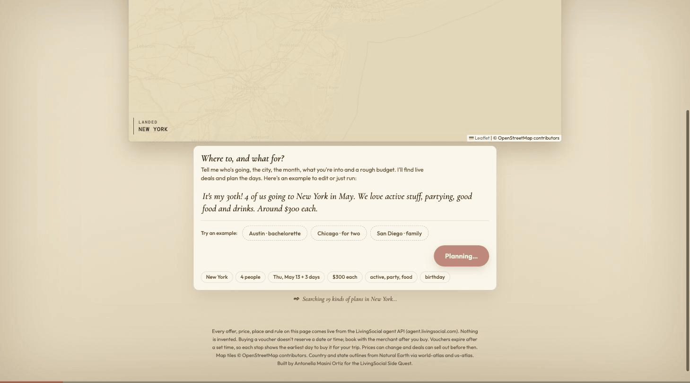

# Side Quest Planner

Tell it the trip like you'd text a friend ("It's my 30th, 4 of us, New York in May, active stuff, partying, good food, around $300 each") and it plans the days around live LivingSocial deals: it reads the fine print, puts each stop on a day it's valid, routes each day on a map and fills one cart.

Live: https://antonellamasini.github.io/side-quest-planner/

Built for the LivingSocial Side Quest (Build It track) by Antonella Masini Ortiz.

## What it does

- **Any US city, plain words.** "Boston, history and seafood, me and my mom, October" works. Cities not on the built-in list are located from the live deals themselves.
- **Plans around the fine print.** Weekday-only, Thursday-only, weekend-only, 21+, dated events and voucher validity decide which day each stop goes on, and empty days say why.
- **Routes each day.** Stops are grouped by distance using the coordinates the API returns; a globe flies into the city and the route is drawn on a map.
- **Group buying.** Picks the option that covers the group for the least money; every stop adds to one LivingSocial cart.
- **Crew vote.** Friends swipe through each stop and nearby alternatives (found with the API's `near` search); votes arrive live and "Lock in the winners" rebuilds the plan.
- **Buy dates.** Vouchers expire, so each stop shows the earliest day to buy it for the trip, with a calendar file of reminders.

## How it works

- One static page, no backend, no API key. The browser calls the public LivingSocial agent API (`https://api-core.livingsocial.com/ls_agent_api`): `offers/search` (including `near` searches for swaps) and `offers/{id}`.
- Every offer, price, place and rule comes from the API. Nothing is invented.
- "Add to cart" uses each option's buy link with the group quantity; the links add to one LivingSocial cart and the person pays on Groupon's checkout.
- Fine-print rules it schedules around: weekday-only, single-day-only, weekend-only, 21+, dated events, and voucher validity (it shows the earliest day to buy each voucher for the trip).
- Globe: d3 + world-atlas / us-atlas (Natural Earth). Street map: Leaflet + OpenStreetMap tiles.

Buying a voucher doesn't reserve a date or time; book with the merchant after you buy.
